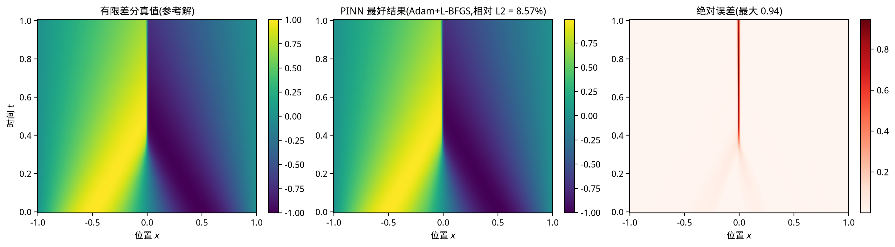

# Repro Lab · 电池 / AI4S 论文复现

两个物理信息神经网络(PINN)论文的**独立复现**,含代码、实跑日志、结果与逐项对比。

> 原则:**只发布我们自己的产物**。第三方论文代码/数据一律不搬运,只提供 patch 与复现结果 —— 读者用原作者仓库 + 我们的 patch 即可复核。

---

## 目录

| 目录 | 内容 | 对应论文 |
|---|---|---|
| `pinn2019-burgers/` | 自写复现代码(正/反问题、Burgers、四组对照、自适应撒点)| Raissi et al., *JCP* 2019 |
| `pinn4soh-2024/` | 补丁说明 + 四数据集结果 + MLP 基线 | Wang et al., *Nat Commun* 2024 |
| `docs/` | 论文分析报告 | — |
| `articles/` | 面向读者的解读文章 | — |

---

## 1. PINN 2019(JCP)· `pinn2019-burgers/`

**论文**:Raissi, Perdikaris, Karniadakis. *Physics-informed neural networks: A deep learning framework for solving forward and inverse problems involving nonlinear PDEs.* J. Comput. Phys. 378:686–707, 2019. DOI [10.1016/j.jcp.2018.10.045](https://doi.org/10.1016/j.jcp.2018.10.045) · 被引 20,000+

**复现结论**:机制成立、精度未达标,且**误差性质与直觉不同**。

### Burgers 方程(`u_t + u u_x − (0.01/π) u_xx = 0`)

| 组 | 设置 | 训练损失 | 相对 L2 误差 |
|---|---|---|---|
| A | `MSE_f + 100·MSE_u`(初始误设) | 方程 0.256 / 数据 1.4e-4 | **36.6%** |
| B | `MSE_f + MSE_u`(论文做法)| 5.8e-3 | **11.2%** |
| C | 同上,Adam 14,000 轮 | 1.3e-3 | **18.2%** |
| **D** | 同上,**Adam 6,000 + L-BFGS** | **1.7e-4** | **8.57%** |
| E | D + 残差自适应重采样 | 9.4e-5 | **38.97%** |
| 论文 | 9 层×20,10,000 配点 | — | **0.197%** |

**三个可复用的结论:**

1. **损失权重能定生死** —— 给初值/边界乘 100,A 组的方程残差是数据项的近 2000 倍,网络实际上放弃了方程。
2. **必须 Adam + L-BFGS 两段式** —— 只堆 Adam 迭代(C 组)会让误差反而变差;补 L-BFGS 后损失再降 22 倍。
3. **训练损失跨设置不可比** —— E 组损失比 D 更低(9.4e-5 vs 1.7e-4),误差却大 4.5 倍,因为损失只在你选的点集上取平均。

### 误差的空间性质

D 组的 8.57% **不是"整体偏"**,而是集中在 `x=0` 的激波上:



> 解的形状全对,唯一偏差是激波位置与陡度差不到一个网格宽度。**总误差会严重高估"方法失效"的程度。**

### 运行

```bash
cd pinn2019-burgers/code
python 01_feasibility.py      # 1D 热传导可行性(约 3 分钟)
python 02_compare.py          # 正问题 vs 有限差分 + 反问题(约 8 分钟)
python 04_burgers.py          # Burgers 正/反问题(约 20 分钟)
python 06_diagnose.py         # 真值体检 + 损失权重 A/B(约 20 分钟)
python 07_paper_setup.py      # Adam + L-BFGS(约 20 分钟)
python 08_adaptive.py         # 残差自适应撒点(约 18 分钟)
```

环境:Python 3.11 / PyTorch 2.x / **CPU 即可**(单线程约 0.15 s/epoch @ 3,000 配点)。

---

## 2. PINN4SOH 2024(Nat Commun)· `pinn4soh-2024/`

**论文**:Wang, Zhai, Zhao, Di, Chen. *Physics-informed neural network for lithium-ion battery degradation stable modeling and prognosis.* Nature Communications 15:4332, 2024. DOI [10.1038/s41467-024-48779-z](https://doi.org/10.1038/s41467-024-48779-z) · 被引 897

**原仓库**:[wang-fujin/PINN4SOH](https://github.com/wang-fujin/PINN4SOH)(**无 LICENSE 文件**,故本仓库不包含其源码与数据)

**复现结论**:**数值复现成功**。

| 数据集 | 论文 MAPE | 本文 MAPE | 偏差 | 可比性 |
|---|---|---|---|---|
| **MIT** | 0.652% | **0.656%** | **+0.6%** | 严格同口径(10 次) |
| **HUST** | 0.778% ± 0.042% | **0.830% ± 0.046%** | **+6.7%** | 严格同口径(10 次) |
| TJU | 1.639% | 1.446%(30 次) | −11.7% | 聚合方式不同 |
| XJTU | 0.703% | 0.852%(60 次) | +21.2% | 聚合方式不同 |

**基线对比**(MIT,MLP 试了 6 种配置取最好):

| 模型 | MAPE | 标准差 |
|---|---|---|
| PINN | **0.656%** | **0.039%** |
| MLP(最好配置) | 1.646% | 0.508% |

> 误差小 2.5 倍、波动小 13 倍 —— 论文"更准更稳"的主张独立成立。

**改动**:见 [`PATCH.md`](pinn4soh-2024/PATCH.md) —— 共 2 处(1 处环境兼容 + 1 处仓库 bug)。

---

## 可复现性观察

同一台 2 核 CPU、同一个复现者:

| | PINN 2019 | PINN4SOH 2024 |
|---|---|---|
| 公开代码 | ❌ | ✅ |
| 公开数据 | ❌ | ✅ |
| 超参数在代码里 | ❌ | ✅ |
| 逐次结果 | ❌ | ✅ |
| 改动 | — | 2 处 |
| 结果偏差 | **43 倍** | **0.6%** |

**选稿建议:把"是否公开代码、数据、超参数、逐次结果"作为硬门槛,优先级高于被引数。**

---

## 许可

本仓库自有代码与文档以 MIT 协议发布(见 `LICENSE`)。**不含任何第三方论文的源码或数据**,对第三方方法的引用仅用于学术复现与评论。
